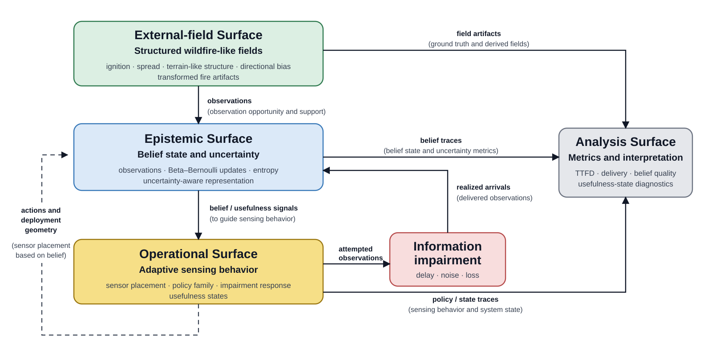

# Summary

AWSRT (Adaptive Wildfire Sensing Research Tool) is research software for studying how adaptive sensing systems maintain an estimate of a changing environment when information is delayed, noisy, or lost. It brings together controlled field generation, sensing-policy experiments, communication impairments, uncertainty and belief-state analysis, inspection of attempted and received observations, and reproducible experiment artifacts within one environment.

AWSRT is designed for experiments in which sensing activity, information delivery, and maintained belief quality must remain distinguishable. It allows researchers to examine whether observations are available, whether they arrive, and how delivered evidence affects an uncertainty-aware belief state, meaning the system's current estimate of the evolving field. AWSRT is a bounded diagnostic research instrument rather than an operational wildfire simulator, digital twin, or emergency-response product.

# Statement of need

Adaptive sensing in dynamic environments couples evolving fields, uncertain observations, constrained sensing resources, information impairment, and belief updating. When these layers are studied separately or connected through ad hoc scripts, it becomes difficult to compare sensing strategies under matched assumptions, preserve reproducible experiment states, or determine how delivery conditions affect maintained belief quality.

AWSRT provides a common experimental environment for these layers. Researchers can vary field structure, sensing behavior, observation support—the spatial or structural region over which evidence contributes to belief—delay, noise, and loss while retaining the resulting arrivals, belief states, metrics, and experiment artifacts for comparison and inspection. This supports research questions in which an observation being attempted, delivered, timely, or belief-improving are distinct events rather than interchangeable measures of sensing success. In this setting, information usefulness refers to whether delivered evidence improves the maintained belief, rather than merely being received. For example, AWSRT can ask: when two sensing strategies observe the same evolving field, does the strategy that delivers more observations also maintain the lower-uncertainty belief under delay, noise, or loss? Existing tools typically provide depth within individual parts of this chain; AWSRT is intended to make the transitions between sensing opportunity, information delivery, and maintained belief experimentally inspectable.

The intended users are researchers studying adaptive sensing, sensor networks, uncertainty-aware inference, information quality, and simulation-assisted analysis in dynamic environments.

# State of the field

Adaptive and informative sensing research already provides sophisticated methods for deciding where, when, and what to observe. Informative path-planning methods select sensing actions or trajectories according to information objectives under resource constraints [@popovic2024adaptiveipp]. Related work on Value of Information and Uncertainty of Information explicitly distinguishes the receipt of observations from their value for estimating or maintaining knowledge of an underlying state [@wang2022voi; @chen2022uoi]. Age-of-information research similarly establishes timeliness as a property distinct from simple message delivery [@kaul2012; @kosta2017]. AWSRT therefore does not introduce uncertainty-aware sensing, information value, or freshness as concepts.

Open-source informative-sensing software also emphasizes action selection. `InformativePathPlanning` provides reusable optimization methods for informative path planning, while `ipp-rl` implements adaptive UAV path planning using deep reinforcement learning [@ott2024approximate; @rueckin2022adaptive]. These tools focus primarily on choosing where to sense; AWSRT complements that emphasis by keeping sensing opportunity, delivery impairment, realized arrivals, and downstream belief consequences separately inspectable.

Existing research software also provides substantially greater specialization on individual parts of the problem. Wildfire simulators such as Cell2Fire model fire growth for wildfire-management and planning studies [@pais2021cell2fire], while network-simulation frameworks such as INET provide detailed communication-network, protocol, mobility, and physical-layer models [@meszaros2019inet]. AWSRT does not attempt to reproduce either level of physical-fire or communication-network fidelity. Its wildfire-like fields and delivery impairments instead provide controlled experimental conditions for studying their downstream consequences for sensing and maintained belief.

AWSRT occupies the experimental junction between these areas. It exposes external-field structure, observation opportunity and support, delivery impairment, realized arrivals, belief updates, sensing behavior, and downstream information-quality diagnostics as separately inspectable stages within one research environment. This permits matched experiments in which information collection, delivery, timeliness, uncertainty reduction, and belief-maintenance usefulness need not be treated as interchangeable. AWSRT was developed as a separate research instrument because the required experimental junction crosses the boundaries of these existing tools. Extending a wildfire-growth simulator would not by itself provide the controlled belief-maintenance and information-delivery experiments required here, while extending a network simulator would not provide the wildfire-like dynamic fields and belief-oriented diagnostics. The purpose of AWSRT is therefore not to replace these tools, but to provide a controlled experimental layer in which their relevant consequences can be studied together. The contribution is a reusable experimental instrument for studying these separations, rather than a new wildfire model, network simulator, information-value theory, or universally optimal sensing controller.

# Software design

AWSRT is organized around four linked research surfaces: External-field, Epistemic, Operational, and Analysis. The External-field Surface provides structured dynamic fields and transformed wildfire-like artifacts as experimental substrates; in the implementation, these functions are primarily provided by the Python simulation and historical-data modules and exposed through the `physical` API and frontend routes. The Epistemic Surface maps to the belief and epistemic modules and corresponding API/frontend components, maintaining belief and uncertainty representations, entropy measures, prescribed observation support, and realized arrivals. In the current epistemic model, each grid cell maintains a Bernoulli probability of binary fire presence using a Beta-Bernoulli update from observations that actually arrive. Belief quality is assessed primarily through uncertainty diagnostics, including cell-wise Shannon entropy, mean entropy over the field, and entropy accumulated over time, rather than being treated as equivalent to message delivery or operational decision quality. The Operational Surface is implemented through sensing-policy, sensor, and operational modules and routes. The Analysis Surface draws on the metrics and analysis components to support metric extraction, figure generation, artifact inspection, and comparison across experimental conditions.

The backend is implemented in Python and exposed through FastAPI routers for physical, epistemic, operational, metrics, and analysis functions. The interactive frontend is implemented in TypeScript using Next.js, with corresponding physical, epistemic, operational, and analysis views. The frontend accesses backend functionality through a small HTTP API client layer rather than embedding experiment logic in the interface. This separation allows experiments to be created and inspected programmatically without the frontend, while new visualizations or interface workflows can be added without altering the underlying research logic. It also retains a direct correspondence between the conceptual research surfaces and inspectable software components.

AWSRT deliberately preserves manifests and associated artifacts so runs and studies remain recoverable and comparable without undocumented local state. It also favors simple, inspectable policy families and diagnostic probes over a single specialized controller. This design favors controlled experimental structure and inspectability, allowing the effects of sensing configuration and information impairment to be isolated under matched conditions. This supports controlled comparison and extension while keeping the relationships among sensing opportunity, information delivery, belief state, and downstream diagnostics visible.

A runnable minimal scientific workflow is provided in [`examples/minimal_scientific_workflow.py`](https://github.com/richardjpurcell/awsrt/blob/main/examples/minimal_scientific_workflow.py), with expected outputs and interpretation documented in [`docs/reproducibility/minimal_scientific_workflow.md`](https://github.com/richardjpurcell/awsrt/blob/main/docs/reproducibility/minimal_scientific_workflow.md). The workflow compares matched zero-loss and total-loss experiments through the public HTTP API and verifies the expected distinction between observation opportunity, delivered evidence, and belief consequence.

# Research impact statement

AWSRT has been used as the experimental research instrument for a PhD thesis on belief maintenance under impaired adaptive sensing and an associated journal manuscript on information delivery versus information usefulness. Paper-facing manifests, metric tables, figures, summaries, and analysis artifacts from this work are preserved in a published reproduction bundle [@purcell2026reproduction].

This research use progressed from sensing-policy comparison through controlled delay, noise, and loss studies to tests of sensitivity to environmental context, deployment geometry, and observation window. AWSRT enabled detection timing, coverage or contact, delivered-information activity, belief quality, and usefulness diagnostics to be examined separately. Subsequent Epistemic Surface studies further separated prescribed observation support, realized arrivals, information activity, and maintained belief quality. The current release-preparation workflow also provides a deterministic scientific first run that exposes the separation among observation opportunity, information delivery, and belief consequence through the public interface.

AWSRT has also been demonstrated within the WireAI research working group. Dr. Darshana Upadhyay independently installed AWSRT on Windows 11 using the repository documentation, ran the full workflow, and demonstrated the resulting system.

AWSRT's demonstrated research role is therefore as an inspectable experimental instrument for studying how sensing opportunity and impaired information delivery affect maintained belief. Its design permits reuse in other dynamic sensing experiments, although external adoption is not claimed here.

# Scope and limitations

AWSRT is bounded research software, not an operational wildfire model or emergency-management platform. Its wildfire-like fields and transformed artifacts are experimental substrates rather than complete wildfire reconstructions. Epistemic support geometries are controlled belief-maintenance probes rather than operational search policies, and usefulness diagnostics describe internal information health rather than validated external decision quality. These boundaries define AWSRT's role as an experimental instrument for studying belief maintenance under impaired information flow.

# Acknowledgements

The author thanks Dr. Srini Sampalli for supervision and guidance throughout this research. The author also thanks Dr. Marzia Zaman and Dr. Darshana Upadhyay of the MYTech Lab for their support.

# AI usage disclosure

OpenAI ChatGPT was used during software development, testing and reproducibility work, documentation preparation, and drafting and editing of manuscript text. Multiple GPT model versions available through ChatGPT were used over the development period; complete historical model-version records were not retained. Assistance included code and test suggestions, debugging and review support, documentation development, and editorial and reasoning support. The author made the primary research, software-architecture, and design decisions and reviewed, modified, tested, and validated AI-assisted outputs through repository inspection, software execution, automated testing, reproducibility checks, and comparison with the intended research design. The author takes responsibility for the software and manuscript content.

# References
